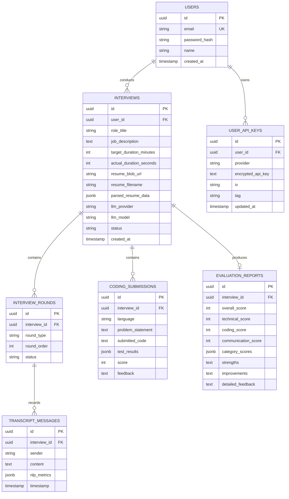

# AI Interviewer - System Architecture

## 1. System Overview
The **AI Interviewer** is an intelligent, multi-provider, conversational interview simulation platform. It analyzes a candidate's Resume and Job Description (JD) using a hybrid **NLP + LLM** pipeline to conduct realistic, context-aware technical, behavioral, and live coding interviews, evaluate candidate performance, and provide actionable feedback.

---

## 2. High-Level Architecture Diagram

```mermaid
flowchart TD
    subgraph Client ["Client (Browser - Next.js 15)"]
        UI["Modern UI (Next.js 15, Tailwind, shadcn/ui)"]
        subgraph MediaUI ["Media & Interview Room"]
            Avatar["3D/Canvas AI Avatar (Audio-Reactive Lip Movement)"]
            UserCam["User Camera Preview (MediaDevices WebCam Stream)"]
            AudioIO["Audio I/O (Web Audio API / SpeechSynthesis / SpeechRecognition)"]
            CodeEditor["Integrated Code Editor (Coding Profile Mode)"]
        end
        AccountUI["Account & History Dashboard (Past Results & Analytics)"]
        KeyStore["Encrypted BYOK Modal (OpenAI / Gemini / Grok / Anthropic)"]
    end

    subgraph Vercel ["Vercel Edge & Serverless Cloud"]
        APIRoutes["Next.js Route Handlers & Server Actions"]
        AuthModule["Account & Auth System (NextAuth / JWT / bcryptjs)"]
        BlobStore["Vercel Blob Storage (Temporary Resume PDFs/DOCX)"]
        EncryptEngine["Encryption Engine (AES-256-GCM for API Keys)"]
        
        subgraph Pipeline ["Hybrid NLP + LLM Core Engine"]
            ResumeParser["Resume & JD Parser (pdf-parse / text normalizer)"]
            TimePacer["Dynamic Time Pacer (15 / 30 / 45 / 60 min session manager)"]
            InterviewOrchestrator["Interview State Machine & Turn Manager"]
            CodingEngine["Coding Challenge & Analysis Engine (JD & Seniority based)"]
            NLPAnalytic["NLP Feature Extractor (Sentiment, WPM, Fillers, Keywords)"]
            LLMAdapter["Unified Multi-LLM Adapter (OpenAI, Gemini, Groq, Anthropic)"]
            LocalSubAgent["Local Mock / Dev Sub-Agent (Zero-Cost Dev Testing)"]
        end
    end

    subgraph DataTier ["Data Tier"]
        PostgresDB[("Supabase PostgreSQL Database")]
        PrismaPooler["Prisma Runtime (POSTGRES_PRISMA_URL - Pooled :6543)"]
        PrismaDirect["Prisma Migration Engine (POSTGRES_URL_NON_POOLING - Direct :5432)"]
    end

    subgraph ExternalLLM ["LLM Providers & Local Engines"]
        AntigravityAgent["Antigravity AI Sub-Agent (Autonomous Built-in Interviewer)"]
        OllamaLocal["Local Ollama (localhost:11434 - Llama 3.2, DeepSeek)"]
        OpenAI["OpenAI API (GPT-4o / GPT-4o-mini)"]
        Gemini["Google Gemini (Gemini 1.5 Pro / Flash)"]
        Groq["Groq / Grok (xAI Grok / Llama-3.3-70b on Groq)"]
        Anthropic["Anthropic Claude (Claude 3.5 Sonnet)"]
    end

    UI --> APIRoutes
    MediaUI --> APIRoutes
    AccountUI --> APIRoutes
    APIRoutes --> AuthModule
    APIRoutes -->|Save Temp Resume| BlobStore
    BlobStore -->|Fetch Document| ResumeParser
    
    APIRoutes --> InterviewOrchestrator
    InterviewOrchestrator --> TimePacer
    InterviewOrchestrator --> CodingEngine
    InterviewOrchestrator --> NLPAnalytic
    InterviewOrchestrator --> LLMAdapter
    InterviewOrchestrator -.->|Local Testing Mode| LocalSubAgent
    
    LLMAdapter -->|Decrypted Key in RAM| OpenAI
    LLMAdapter -->|Decrypted Key in RAM| Gemini
    LLMAdapter -->|Decrypted Key in RAM| Groq
    LLMAdapter -->|Decrypted Key in RAM| Anthropic
    
    APIRoutes <--> PostgresDB
    EncryptEngine <--> APIRoutes
```

---

## 3. Core Architectural Components

### 3.1. Account Management & Historical Results
- **Authentication**: Email & Password auth using secure password hashing (`bcryptjs`) + JWT sessions.
- **Account Dashboard**:
  - User profile and active BYOK keys.
  - History of all past interviews with filter by role, date, and score.
  - Performance analytics (trend charts showing progress in technical depth, communication, and coding scores over time).
  - Full report view for any past interview with saved question transcripts and audio/text feedback.

---

### 3.2. Configurable Session Duration & Dynamic Pacing Engine
- **User Configured Duration**: 15 min, 30 min, 45 min, or 60 min.
- **Dynamic Time Pacer (`TimePacer`)**:
  - Automatically calculates phase allocations based on selected time:
    - **Introduction & Icebreaker**: 5-10% of total time.
    - **Resume & Experience Deep Dive**: 25-30% of total time.
    - **Technical / Coding Challenge**: 35-40% of total time.
    - **Behavioral / System Design**: 15-20% of total time.
    - **Candidate Questions & Wrap-up**: 5-10% of total time.
  - Warns the candidate when 5 minutes remain and initiates closing questions.

---

### 3.3. Realistic Video Call Experience (Avatar + WebCam)
- **Interactive AI Avatar**:
  - Rendered on-screen with real-time audio-reactive lip movement (using Web Audio API analyser node to drive mouth open/closed viseme animation).
  - Visual states: Idle/Listening (blinking, subtle breathing, nodding), Thinking (processing response), and Speaking (lip-sync synchronized to audio playback).
- **Candidate WebCam Preview**:
  - Live video feed via browser `navigator.mediaDevices.getUserMedia`.
  - Realistic split-screen or picture-in-picture video conference interface (Google Meet / Zoom aesthetic).

---

### 3.4. Technical & Coding Profile Engine
- **Coding Assessment Tailored to JD & Experience Level**:
  - Calibrated by experience: Entry (syntax, basic algorithms, data structures), Mid (medium algorithms, concurrency, system components), Senior/Lead (complex algorithms, architecture, scalability, edge-case resilience).
- **In-Browser Code Editor**:
  - Interactive multi-language editor (JavaScript, TypeScript, Python, Java, C++, Go, SQL).
  - Code execution simulator and test runner.
- **Automated Code Analysis**:
  - LLM + static NLP analysis evaluating:
    - Correctness & edge-case handling.
    - Time and space complexity ($O(N)$, $O(1)$, etc.).
    - Code style, readability, and modularity.
    - Integration of coding score into the final comprehensive report.

---

### 3.5. Hybrid NLP + LLM Engine
| Responsibility | Technique / Library | Purpose |
|---|---|---|
| **Resume & JD Ingestion** | `pdf-parse`, `mammoth`, text normalizer | Extracts structured sections: Skills, Experiences, Projects, Education, JD requirements. |
| **Speech-to-Text (STT)** | Web Speech API (Client) / OpenAI Whisper API / Groq Whisper (BYOK) | Real-time candidate speech capture with low latency. |
| **Real-Time Speech NLP** | `compromise`, custom speech analytics | Calculates filler word count (*"um", "like", "you know"*), speech rate (words per minute), speaking-to-listening ratio, confidence markers. |
| **Semantic Matching** | Cosine similarity / embeddings / token overlap | Checks if candidate's response addressed key technical concepts from the JD before triggering LLM follow-ups. |
| **Dynamic Interviewer LLM** | Unified LLM abstraction layer | Formulates contextual questions, challenges claims from the resume, adapts difficulty, and avoids scripted loops. |
| **Text-to-Speech (TTS)** | Web Speech Synthesis / ElevenLabs / OpenAI TTS | Natural human-like audio delivery driving avatar lip sync. |
| **Post-Interview Rubric** | LLM + NLP Evaluation Engine | Multidimensional scorecard (Technical Accuracy, Coding Performance, Relevance, Communication, Confidence, JD fit). |

---

### 3.6. Multi-LLM Provider Layer (BYOK - Bring Your Own Key)
- Supported Providers:
  - **OpenAI**: GPT-4o, GPT-4o-mini
  - **Google Gemini**: Gemini 1.5 Pro, Gemini 1.5 Flash
  - **Groq**: Llama-3.3-70B, Mixtral (ultra-low latency for conversational voice)
  - **xAI Grok**: Grok-2 / Grok-beta
  - **Anthropic**: Claude 3.5 Sonnet
- **Encryption**: AES-256-GCM cipher with per-key IV and authentication tag, zero-log policy.

---

### 3.7. Local Engines: Antigravity Sub-Agent vs. Ollama
The system provides two distinct local, zero-cost options:
1. **Antigravity AI Sub-Agent (`AntigravityInterviewSubAgent`)**:
   - Built-in autonomous backend agent assigned directly as Lead Technical Interviewer.
   - Operates in place of external LLMs without requiring any API keys.
   - Drives multi-stage conversational state transitions, dynamic JD-resume gap analysis, live coding challenge assignment, code review, and post-interview synthesis.
2. **Local Ollama Runtime (`OllamaAdapter`)**:
   - Connects directly to local Ollama daemon on `http://127.0.0.1:11434`.
   - Supports local models (e.g. `llama3.2`, `deepseek-r1:1.5b`, `mistral`, `qwen2.5`).
   - Built-in ping/health-check verifying daemon reachability and available models.

---

### 3.8. Database Schema Design (PostgreSQL)

